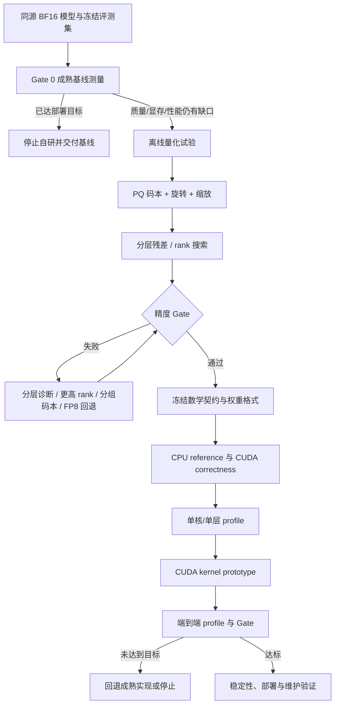

# Transformer Engine 与 Faiss 混合压缩及推理优化方案（V2.6 评审与原型验证计划）

## V2.6 修订说明

> 修订日期：2026-11-25（Asia/Shanghai）。本版完整保留 V2.4 原文、V2.5 审阅补充/更正和附录 A，并新增**附录 B（第三方评析）**和 **B0 合并决策**。凡标"估算"的数字均未实测。

### 相对 V2.5 的主要变更

| # | 变更 | 影响章节 | 类型 |
|---|---|---|---|
| 1 | 文档状态由"工程定稿"改为"评审与原型验证计划" | 标题 / A11 | 定性 |
| 2 | 解码 LUT 查表默认走 **SMEM 切片**，L2 直查降为对照路径；新增 gather 吞吐微基准，作为内核开发的前置门 | 4.1 / A6 / 附录 B 2.1 | 设计变更 |
| 3 | 码本用 L2 持久化窗口常驻，码本流量目标由 0.369 GB 压回约 0.092 GB/token | 4.3 / 附录 B 2.2 | 优化 |
| 4 | PQ 前新增**按行 RMS 归一化**和 FP16 行尺度（约 2.1 MB） | 3 / 1.2 / 附录 B 2.3 | 设计变更 |
| 5 | 精度路线改为三组同体积 A/B：冻结码本 + rank64 / 微调质心 + rank32 / 微调质心 + 敏感层二级码本 | 3.5 / 5 / 附录 B 2.4 | 流程变更 |
| 6 | k-means 改为按子空间 4×4 激活二阶矩加权（先白化再交给 Faiss） | 3.3 / 附录 B 2.5 | 优化 |
| 7 | Gate 0 加入 **AQLM 1×16 / 2×8** 与"注意力 W4 + FFN 原方案"组合 | A3 / 附录 B 2.6–2.7 | 基线扩充 |
| 8 | 新增两条停机规则（gather 过慢；同体积精度不优于 AQLM） | A1 / 1.3 | 决策规则 |
| 9 | 工作量预算由 13–31 人周调整为 **20–40 人周**，并在微基准完成后重估 | A9 | 预算 |
| 10 | C 门 MMLU ≤ 1 分改为努力目标；硬门改为"目标任务非劣 + PPL 相对增幅上限 + 预填/解码逐层余弦一致性" | 5 / A4 | 门槛 |

### B0. 合并后的决策与第 1 周行动

**批准范围**：Gate 0 基线测量 + 两项快速判定实验，可以并行：
1. **gather 微基准**：随机 uint8 码 + 随机 FP16 LUT，对比 L2 直查和 SMEM 切片，测出每 token 约 1.41×10⁹ 次查找的实际耗时。
2. **单层 PQ 离线实验**：在 1–2 层 FFN 上对比有/无行归一化、有/无 Σ 加权，测输出 MSE 和单层 KL。

**停机规则（在 A1、1.3 的基础上新增）**：
- FFN 查表 > 1.2 ms/token 且找不到缓解手段 → 放弃自研解码内核。
- 同等体积下精度不优于 AQLM 2-bit → 直接采用 AQLM 或成熟 4-bit 方案。

**暂不批准**：全量 CUDA 内核开发、KV offload、长期维护投入。

---


## 审阅总览

> 审阅日期：2026-11-24（America/Los_Angeles）。本节省为审阅新增，不改动原标题与后文原句。体积一律按原文口径：十进制 GB（$10^9$ 字节）。能由公开结构参数推出的数字均已用 Python 复核；引用的公开数据给出出处；无法确证的标“待实测”或“需查证”，不编造数字。

### 适用范围

* 核算对象与原文一致：Llama 3 8B 公开结构（隐藏维度 4096，FFN 中间维度 14336，32 层，注意力头 32，KV 头 8，头维度 128，词表 128256，嵌入与输出头不共享）。据此得到总参数 $8{,}030{,}261{,}248$（含 3 组 RMSNorm $266{,}240$ 个参数），与公开的 8.03B 一致。
* 硬件前提：注意力与预填 FFN / 输出头的 FP8 GEMM 依赖 Transformer Engine。官方支持矩阵（Transformer Engine 2.21.0）确认：**Hopper / Ada / Blackwell**（计算能力 $\ge 8.9$）支持逐张量 FP8；**Ampere（A100、RTX 30 等）不支持 FP8**。Ada 还需要 cuBLASLt $\ge 12.1.3$ 且 CUDA $\ge 12.1$。本方案不能直接搬到 Ampere 卡上用 TE FP8。
* 原文 Roofline 与网格设计以 H100 为参照。H100 SXM 官方峰值带宽为 3.35 TB/s、132 SM；H100 PCIe 为 2.0 TB/s、114 SM。文中“$\sim$3.0 TB/s 有效带宽”只宜当作 SXM 的有效带宽假设，不能直接用于 PCIe。
* 本审阅只针对这一份压缩与推理方案，不把其他机器的约束写进本文。

### 补充标记说明

* **【审阅补充】**：在原文之后增加核算、出处、风险或判断，不改原句。
* **【审阅更正】**：原文数字或事实有误时，保留原句，在其后给出正确值与推导。
* “待实测 / 需查证”：当前无法由结构参数或公开文献单独确证。

### 核算结果汇总

| 条目 | 原文 | 复核（十进制，精确值） | 结论 |
| --- | --- | --- | --- |
| 注意力 QKVO，FP8 | $32 \times 41{,}943{,}040$，**1.342 GB** | $1{,}342{,}177{,}280$ B $= 1.342177$ GB | 正确（三位小数） |
| 词嵌入 + 输出头，1 字节 | $2 \times 525{,}336{,}576$，**1.051 GB** | $1{,}050{,}673{,}152$ B $= 1.050673$ GB | 公式正确；四舍五入到 1.051 |
| 行缩放（FP16） | $\sim$0.5 MB | $2 \times 128256 \times 2 = 513{,}024$ B $= 0.513$ MB | 正确（约数） |
| FFN 码，$dsub=4$、8 bit | $5{,}637{,}144{,}576 / 4$，**1.409 GB** | $1{,}409{,}286{,}144$ B $= 1.409286$ GB | 正确 |
| 码本，8 组，质心 FP16 | $8 \times 256 \times 22528 \times 2$，**0.092 GB** | $92{,}274{,}688$ B $= 0.092275$ GB；$22528=(1024+1024+3584)\times 4$ | 正确 |
| 残差 rank 64，BF16 | $96 \times 64 \times 18432 \times 2$，**0.226 GB** | $226{,}492{,}416$ B $= 0.226492$ GB；$18432=4096+14336$ | 正确 |
| 默认纯权重合计 | **4.120 GB** | 精确合计 $4{,}120{,}903{,}680$ B $= 4.120904$ GB；表内三位小数相加得 4.120 | 口径成立 |
| rank 32 变体 | **4.007 GB** | $4{,}007{,}657{,}472$ B $= 4.007657$ GB | 口径成立 |
| 行缩放 + 归一化 | 行缩放 $\sim$0.5 MB，归一化 $<0.5$ MB | 归一化 $266{,}240 \times 2 = 532{,}480$ B $= 0.532$ MB | 归一化略低估 |
| 含缩放与 Norm 的权重 | （未单列） | $4.121949$ GB | 补充 |
| 全模型 FP16 / 全 FP8 | 16.06 GB / 8.03 GB | $16.060522$ / $8.030261$ GB（含 Norm） | 正确 |
| 预填双层 Ping-Pong | 0.352 GB | $2 \times 176{,}160{,}768$ B $= 0.352322$ GB | 正确 |
| FP16 KV，$B=1$, $L=2048$ | 0.268 GB | $268{,}435{,}456$ B $= 0.268435$ GB | 正确 |
| 每 token KV / 128K 上下文 | 128 KiB / $\sim$16 GiB | $131{,}072$ B $= 128$ KiB；$131072^2$ B $= 16$ GiB 整 | 正确 |
| LUT `gate` / `down` | 0.524 MB / 1.835 MB | $524{,}288$ B / $1{,}835{,}008$ B | 正确 |
| $B=4$ 时 `down` 表 | 约 7.3 MB | 7.340 MB | 正确 |
| Split-K 部分和 | 229$\sim$256 KB | `gate` $229{,}376$ B；`down` $262{,}144$ B（$=256$ KiB） | 基本正确，单位略混用 |
| H100 网格块数 | 224 / 256 | 与 `block=256`、`SPLIT_K=4/16` 一致，且 $M/16$ 可整除 | 正确 |
| 退 1 层 FFN 到 FP8 | $0.1762-0.0474=0.1288$ GB；总重 4.249 / 4.378 / 4.635 GB | 默认 rank 64 应为 $0.176161-0.051118=0.125043$ GB；总重 4.246 / 4.371 / 4.621 GB | **有误** |
| Roofline 权重读量 | 3.594 GB $\rightarrow$ $\sim$1.20 ms/tok、$\sim$830 tok/s | 分项四舍五入成立；码本应按 4 次读取计 $0.369$ GB，合计约 $3.872$ GB、$1.29$ ms/tok | **口径需修正** |
| 全 FP8 解码读量 | $\sim$7.50 GB $\rightarrow$ $\sim$2.50 ms/tok | $8.030261-0.525337=7.504925$ GB（已扣嵌入）；$\div 3.0$ TB/s $=2.50$ ms | 正确 |
| 两份 4096×4096 FP32 OPQ | 0.134 GB | $134{,}217{,}728$ B $= 0.134218$ GB | 正确 |
| 一次展开 32 层 FFN | 5.64 GB | $5.637145$ GB（按 FP8） | 正确（约数） |
| AWQ 词表 BF16 / 1 字节 | 约 5.5 GB / 约 4.3 GB | 同口径核算约 5.73 GB / 4.68 GB | 约数偏低 |
| 峰值显存 | $\approx$ **5.19 GB** | $4.120+0.352+0.268+0.002+0.45=5.192$，加和正确，但是乐观下界 | 口径说明 |

### 主要结论（按严重程度）

1. **【严重】“2-bit 下 AQLM MMLU 掉点可 $<2$ 分”与公开数据不符。** 官方 Llama 3 8B AQLM 2-bit（1×16 码本）MMLU 5-shot 从 65.25 降到 56.47，掉 **8.78 分**（Hugging Face `ISTA-DASLab/Meta-Llama-3-8B-AQLM-2Bit-1x16`，页面标注 UPD 02.05.2024）。AQLM 论文（arXiv:2401.06118）在 Llama 2 上、端到端微调后的 2-bit MMLU 掉点为 7B **−7.4**、13B **−6.4**、70B **−3.5**，同样不是 $<2$。较接近“不到 2 分”的是 Llama 2 70B 的五任务 zero-shot 平均（70.17→68.75，−1.42），那不是 MMLU，也不是 8B。与此同时，第 5 节门槛 C 要求 MMLU $\le 1$ 分，严于 8B 级 2-bit 公开 SOTA。立项时就要决定：是放宽门槛，还是接受本方案可能过不了 C 门。
2. **【严重】回退 FP8 的 $0.0474/0.1288$ GB 以及 4.249 / 4.378 / 4.635 GB，与默认 rank 64 不一致。** 默认 rank 64 下，一层压缩体积（码 + 残差；码本仍留给同组其他层）是 **0.051118 GB**，净增 **0.125043 GB**。退 1 / 2 / 4 层后总重应为 **4.246 / 4.371 / 4.621 GB**（相对精确合计 4.120904 GB）。$0.0474$ 更接近 rank 32、不含码本分摊的 0.047579 GB，像是旧稿数字未随默认 rank 同步。
3. **【中等】第 5 节阶段 C 失败处置写“启用 rank 64”，与第 1 节默认已是 rank 64 矛盾。** 默认就是 64，可降为 32；失败处置应为“维持或按层升到 64 已无空间，再考虑最差层退 FP8”。
4. **【中等】Roofline 把 8 组码本只计一次 0.092 GB，但每组被 4 层各读一次，码本流量应为 0.369 GB。** 全模型读权下界由 3.595 GB / 1.20 ms/tok 修正为约 **3.872 GB / 1.29 ms/tok**（仍按 3.0 TB/s）。另缺 KV：$L=2048$ 时再加 0.268 GB、约 0.089 ms。定性结论“约为全 FP8 解码读量的一半”仍然成立。3.0 TB/s 只适用于 H100 SXM 的有效带宽假设。
5. **【中等】端到端 5.19 GB 是各分项相加的乐观下界，8 GB 卡“略紧凑”偏乐观。** 未计入预填激活、分配器碎片，以及 CUDA / PyTorch 上下文是否真只有 $\sim$0.45 GB（待实测）。16 GB 余量判断合理。
6. **【中等】把本文称作“工程定稿”偏早。** 离线 Faiss `train` / `compute_codes` 确实工程极简，但在线路径是自研 LUT-GEMV、融合 Epilogue、残差小核、TE 预填和 CUDA Graph；内核尚未落地，本方案自己的精度也还未测过。宜先做 Gate 0（测量成熟方案），再冻结契约，最后才写内核。
7. **【较低】若干约数可再收紧：** 归一化是 0.532 MB 而不是 $<0.5$ MB；AWQ“约 5.5 / 4.3 GB”偏低（同口径约 5.73 / 4.68 GB）。另外，预填只写“解压为旋转后的 FP8 权重”，未写如何把低秩残差折进旋转域，存在预填漏掉残差、与解码不一致的风险。

### 总体判断（摘要）

方案取舍的方向是清楚的：注意力与词表走 FP8 / 行缩放，把最占体积的 FFN 收到约 2 bit，再用 rank 64 残差兜底；阶段 A 的停机规则也正确，应当保留并真正执行。主要风险不在表里那 4.120 GB 算不算得过来，而在于 **单码本 PQ（$dsub=4$）在 8B、2-bit 上的重建自由度明显低于 AQLM / QTIP，却把 MMLU 门槛设得比公开 SOTA 更严**；以及 **自定义解码内核的工程量和 Tensor Core 路径的差距**，可能让“权重读量减半”落不成“达到 FP8 基线 90% 吞吐”。建议的实施顺序见文末。

> **版本说明**：本版整合了 V2.3 主方案与全部硬件/工程审校结论，消除了“正文与评审节各自独立”的割裂，修复了通道缩放 FP16 溢出隐患、SMEM/L2 查表路径冲突、残差融合缺失及全模型 Roofline 口径问题。

核算对象为 **Llama 3 8B** 公开结构：隐藏维度 4096，FFN 中间维度 14336，32 层，注意力头 32，KV 头 8，头维度 128，词表 128256，嵌入与输出头不共享。体积按十进制 GB（$10^9$ 字节）计算。

---

## 1. 结论、方案取舍与显存预算

### 1.1 与成熟 VQ 方案（AQLM / QTIP / QuIP#）的取舍
本方案本质为“正交旋转 + 单码本乘积量化（`dsub=4`）+ 低秩残差”，重建自由度低于 AQLM / QTIP 等多码本加性向量量化~~（2-bit 下业界报告 AQLM MMLU 掉点可 $<2$ 分）~~。**选择 Faiss PQ 的核心理由是离线 CPU 一步 `train`/`compute_codes` 工程极简**，代价是更依赖残差蒸馏兜底。

> **【审阅更正】** “2-bit 下业界报告 AQLM MMLU 掉点可 $<2$ 分”与公开数据不符，不宜作为本方案的质量参照。
>
> * Llama 3 8B 官方 AQLM 2-bit（1×16）：MMLU 5-shot **65.25 → 56.47（−8.78 分）**，模型体积 16.1 → 4.1 GB。来源：Hugging Face `ISTA-DASLab/Meta-Llama-3-8B-AQLM-2Bit-1x16`，页面标注 UPD 02.05.2024。
> * AQLM 论文（Egiazarian 等，arXiv:2401.06118，Appendix K Table 15，端到端微调，MMLU 5-shot）在 Llama 2 上：7B **45.9 → 38.5（−7.4）**，13B **55.2 → 48.8（−6.4）**，70B **68.8 → 65.3（−3.5）**。即使 70B 也不是 $<2$ 分。
> * 较接近“不到 2 分”的公开数字，是同论文 Table 1 里 Llama 2 70B AQLM 2.07-bit 的五任务 zero-shot 平均（70.17 → 68.75，−1.42）。那不是 MMLU，也不能外推到 8B。
>
> **【审阅补充】** 单码本乘积量化（$dsub=4$、每子空间 256 中心）重建自由度确实低于 AQLM / QTIP / QuIP# 的多码本或格点 / trellis 量化，这一点原文判断正确；残差蒸馏是必要兜底，不是可选项。QTIP 论文（arXiv:2406.11235，Table 7，Llama 3 8B，上下文 8192）给出的 2-bit PPL 为：BF16 WikiText-2 / C4 = 5.54 / 7.10，QTIP 2-bit = 7.33 / 8.62，QuIP# 2-bit = 7.84 / 9.06。这组数据没有 MMLU。本方案 FFN 为 2.0 bit/参数，加上 rank 64 残差约合 **0.32 bit/参数**（$64\times 18432\times 16 / 58720256$），有效载荷大约 2.3 bit/FFN 参数，仍属极限压缩。选择 Faiss 是为了离线工程简单，这个理由成立；但它不降低在线内核和精度风险。与 AQLM 2-bit 已有约 4.1 GB 现成权重相比，本方案默认 4.120 GB 并不更省，优势只能来自自研内核或更高精度——二者都还待证实。

### 1.2 纯权重体积与端到端峰值显存
精度优先的默认配置为 ~~**4.120 GB**~~ **约 4.123 GB（V2.6，含行尺度）**（FP16 为 16.06 GB，全 FP8 为 8.03 GB）；若部署硬顶为 4.00 GB，可将残差降为 BF16 rank 32（合计 **4.007 GB**），但可训练自由度减半，过第 6 节门槛风险更高。

| 张量模块 | 策略 | 精确字节 | 体积 |
| --- | --- | ---: | ---: |
| 注意力 Q、K、V、O | FP8 E4M3，走 Transformer Engine | `32 × 41,943,040` | **1.342 GB** |
| 词嵌入与输出头 | 每行 1 字节 + FP16 行缩放（嵌入查表，输出头走缩放 GEMV / FP8） | `2 × 525,336,576` | **1.051 GB** |
| FFN 码 (`gate`/`up`/`down`) | Faiss PQ，`dsub = 4`，8 bit（**2.0 bit/参数**） | `5,637,144,576 / 4` | **1.409 GB** |
| FFN 分组共享码本 | 默认每 4 层一组（共 8 组）；`gate`/`up`/`down` 分开；质心 FP16 | `8 × 256 × 22528 × 2` | **0.092 GB** |
| FFN 低秩残差（默认） | BF16，**rank 64**（可按层非均匀搜索 32/64），输入为未旋转激活 | `96 × 64 × 18432 × 2` | **0.226 GB** |
| **纯权重合计（默认）** | *(rank 32 变体为 4.007 GB；行缩放 ~0.5 MB 与归一化 <0.5 MB 略)* | | **4.120 GB** |

> **【审阅补充】** 表内字节公式均已复核，成立。精确合计（不含行缩放与 Norm）为 $4{,}120{,}903{,}680$ 字节 $= 4.120904$ GB；4.120 GB 是把各行先四舍五入到 0.001 GB 再相加的结果（$1.342+1.051+1.409+0.092+0.226$）。词嵌入与输出头那一行的 $2\times 525{,}336{,}576$ 只含 1 字节本体（$1.050673$ GB），写成 1.051 GB 是四舍五入。行缩放 $513{,}024$ 字节（$0.513$ MB）与 RMSNorm $532{,}480$ 字节（**$0.532$ MB，不是 $<0.5$ MB**）另计后，权重大约 **4.122 GB**。Llama 3 8B 总参数 $8{,}030{,}261{,}248$，全 FP16 / 全 FP8 分别为 16.060522 / 8.030261 GB，与 16.06 / 8.03 GB 一致。

> **【V2.6 修订】** 新增按行 FP16 尺度：$(14336+14336+4096)\times 32\times 2 = 2{,}097{,}152$ B ≈ **0.002 GB**，默认纯权重合计约 **4.123 GB**（不含行缩放与 Norm）。见变更 #4。

**端到端运行峰值显存估算（`batch=1`, 上下文 `2048`）**：
* 权重（4.120 GB）+ 预填双层 Ping-Pong 缓冲（0.352 GB）+ FP16 KV Cache（0.268 GB）+ 单层 `__half` LUT 与部分和（~0.002 GB）+ CUDA/TE/cuBLAS 上下文（~0.45 GB）$\approx$ **5.19 GB**（16 GB 卡余量充足，8 GB 卡略紧凑）。

> **【审阅补充】** $4.120+0.352+0.268+0.002+0.45=5.192$，与 $\approx 5.19$ GB 的加和一致，但这是乐观下界，不是实测峰值。
>
> * 预填双层缓冲 $0.352$ GB 与解码期 LUT（$\sim 0.002$ GB）通常不同时存在，这一项反而可能略高估解码峰值。
> * 真正缺的是 **预填激活**（$L=2048$ 时 `gate`/`up` 一类中间张量，即便用 Flash Attention，FFN 中间激活仍可能到百兆量级）和分配器碎片。
> * CUDA / TE / cuBLAS 上下文 $\sim 0.45$ GB 是估计，**待实测**；PyTorch 进程在 8 GB 卡上常常明显高于这个数。
> * 因此：**16 GB 卡余量充足**这一句可以保留；**8 GB 卡略紧凑**偏乐观，必须在目标卡上按 Gate 0 实测后再下结论，不宜在方案里写成已经够用。

### 1.3 先行停机规则与回退代价曲线
1. **基线停机**：同一检查点先测 BF16、TE FP8（8.03 GB）及**同口径**（词表同样收为 1 字节 vs BF16）的成熟 4-bit 方案（如 AWQ：词表 BF16 时约 5.5 GB，词表 1 字节时约 4.3 GB）。若现成方案已达标，**立刻交付，不写自定义 Kernel**。

> **【审阅补充】** 阶段 A 的停机规则正确，而且应该是本方案的第一硬约束：现成方案达标就不写自定义 Kernel。AWQ 体积“约 5.5 GB / 约 4.3 GB”作为数量级可以，但略偏低。按 group=128、FP16 尺度 + 4-bit 零点、注意力与 FFN 走 4-bit、Norm 为 FP16 核算：词表保持 BF16 时约 **5.73 GB**（$3.490+0.109+0.027+2.101+0.0005$），词表改为与本文相同的“每行 1 字节 + FP16 行缩放”时约 **4.68 GB**（节省约 1.05 GB，不是 1.2 GB）。公开 AWQ 权重常见体积约 5.7 GB 量级（检索于 2026-11-24，如 `casperhansen/llama-3-8b-instruct-awq` 约 5.74 GB），与 5.73 GB 的核算相符。基线集合还应加上 GPTQ 以及 llama.cpp / GGUF（`Q4_K_M`、`Q3_K`、`IQ2_XXS` 等），因为 8 GB 级部署里这往往是最省事的对照。
2. **回退 FP8 的容量代价**：每将 1 个完整 FFN 层（`gate`+`up`+`down`）退回 FP8，净增体积 ~~`0.1762 - 0.0474 = 0.1288 GB`（退 1 层总重达 **4.249 GB**，退 2 层达 **4.378 GB**，退 4 层达 **4.635 GB**）~~ **0.125043 GB（退 1/2/4 层：4.246 / 4.371 / 4.621 GB，未含行尺度）**。若硬顶卡死 4.12 GB，则必须在立项时明确“精度不达标即放弃或放宽硬顶”。

> **【审阅更正】** 回退代价应按默认 rank 64 重算，原文 $0.0474/0.1288$ 与后续总重像是沿用了 rank 32 口径。
>
> 一层完整 FFN 的 FP8 体积为 $176{,}160{,}768$ 字节 $= 0.176161$ GB（写成 0.1762 GB 可以）。默认 rank 64 下，该层被替换掉的压缩部分是：
>
> * 码：$176{,}160{,}768/4 = 44{,}040{,}192$ B $= 0.044040$ GB
> * 残差：$3 \times 64 \times 18432 \times 2 = 7{,}077{,}888$ B $= 0.007078$ GB
> * 合计 **$0.051118$ GB**（码本按 4 层一组共享，退单层时通常不能丢掉整组码本，故此处不扣码本）
>
> 净增应为 $0.176161 - 0.051118 = $ **$0.125043$ GB**，不是 $0.1288$ GB。$0.0474$ 更接近 rank 32、只计码 + 残差的 $0.047579$ GB；若用这个数去减 FP8，净增 $0.128582$ GB，与原文 0.1288 相近。
>
> 以精确默认合计 $4.120904$ GB 为起点，退 1 / 2 / 4 层（保留码本）后总重为 **4.246 / 4.371 / 4.621 GB**，不是 4.249 / 4.378 / 4.635 GB。若连续 4 层恰好是一整组、码本也可丢掉，还可再减 $0.011534$ GB，得 4.610 GB。硬顶若卡死在 4.12 GB，退一层就会破顶——这句判断仍然成立，只是破顶后的数字应改用上面这组。

> **【V2.6 修订】** 新增两条停机规则：① gather 微基准显示 FFN 查表 > 1.2 ms/token 且找不到缓解手段 → 放弃自研解码内核；② 同等体积下精度不优于 AQLM 2-bit → 直接采用 AQLM 或成熟 4-bit 方案。见变更 #8。

---

## 2. 两库边界、通道缩放（防溢出）与正交旋转

* **Transformer Engine (TE)**：负责稠密矩阵算子——注意力 Q/K/V/O、预填展开 FFN 及预填输出头 FP8 GEMM（需 Hopper/Ada/Blackwell）。

> **【审阅补充】** “需 Hopper / Ada / Blackwell”成立。Transformer Engine 2.21.0 官方支持矩阵：计算能力 8.9（Ada，如 L40S、RTX 40）及 9.0（Hopper）、10.x / 12.0（Blackwell）支持逐张量 FP8；计算能力 8.0 / 8.6（Ampere）仅支持 BF16 / FP16，不支持 FP8。Ada 额外要求 cuBLASLt $\ge 12.1.3$、CUDA $\ge 12.1$。来源：<https://docs.nvidia.com/deeplearning/transformer-engine/support_matrix.html>。解码阶段 $B=1$ 的 Q/K/V/O 与输出头实质是 GEMV（$M=1$），FP8 Tensor Core 通常要求 $M$ 为 16 或 64 的倍数，**TE FP8 GEMM 在解码小批量上未必能吃到 Tensor Core**，吞吐待实测；真正能稳定走 TE FP8 的是预填大 $M$ GEMM。
* **Faiss**：**仅在离线 CPU 端**调用 `ProductQuantizer` 的 `train` 与 `compute_codes`；不调用 `search()`，不建 `IndexIVFPQ` 或 `GpuIndex`。

> **【审阅补充】** Faiss C++ API 与原文一致：`faiss::ProductQuantizer(d, M, nbits)` 要求 $d$ 能被 $M$ 整除，$nbits=8$ 时每子量化器 256 个中心；离线只用 `train` 与 `compute_codes` 是正确用法，不应调用 `search()`，也不需要 `IndexIVFPQ` / `GpuIndex`。来源：Faiss `ProductQuantizer.h`。本模型上 `gate`/`up` 为 $(d,M)=(4096,1024)$，`down` 为 $(14336,3584)$，$dsub=4$，均整除。须注意：Faiss PQ 默认按 L2 k-means 训中心，量化误差偏向 L2 而不是内积；对权重行做重建通常仍可接受，但与“服务 GEMV 内积”的目标并不完全同一，精度影响待实测。
* **自研中间层**：列缩放 + 正交旋转 + 交错重排 + 解码双段 LUT-GEMV + 融合 Epilogue + 预填双层 Ping-Pong 解压。

### 2.1 输入通道缩放（修复 FP16 溢出隐患）
输入通道 $j$ 对应权重矩阵 $W$ 的**列**。离线统计通道均方根 $s_j = \text{RMS}(x_j)^\alpha$（默认 $\alpha=1$），令 $W_s = W \text{diag}(s)$、$x_s = x \text{diag}(s)^{-1}$。
* **安全钳位规则（关键修复）**：由于在线旋转激活 `x_rot` 与质心均以 **FP16（上限 `65,504`）** 存储，若死通道 $s_j$ 钳在 `1e-5`（倒数 `1e5`），折叠进 `RMSNorm` 后会**直接溢出 FP16 产生 `Inf/NaN`**。必须先按各层通道中位数归一化 $s_j$，再将其**双侧钳位至 `[0.05, 20.0]`**，且确保折叠后的 `gamma` 绝对值不超过 `64.0`。

> **【审阅补充】** FP16 有限最大值确为 **65504**。若死通道 $s_j$ 钳在 $10^{-5}$，倒数 $10^{5}>65504$，折进 `RMSNorm` 的 `gamma` 后在 FP16 链路上会溢出，这一隐患判断正确，V2.4 的双侧钳位是必要修复。补充三点：（1）若 `gamma` 保持 BF16（Llama 3 8B 教师权重常见如此），BF16 动态范围极大，溢出主要发生在把激活或 `gamma` 写成 FP16 的路径，契约里应写清各张量的存储精度。（2）钳到 $[0.05,20]$ 后再要求 $|\gamma|\le 64$，会牺牲部分死通道 / 热通道的缩放质量，对重建误差的影响待实测。（3）应用 $1/\sqrt{d}$ 和旋转之后，在线 `x_rot` 与 FP16 质心的点积仍建议先在 FP32 累加（内核已这样做），再写回 `__half` LUT。
* **折叠位置**：`gate`/`up` 的 $s^{-1}$ 折叠进前序 `RMSNorm` 的 `gamma`（零开销）；`down` 前无 Norm，将 $s_{\text{down}}^{-1}$ 融合进第 4 节 `SwiGLU` Epilogue 的寄存器乘法中（`down` 残差仍吃乘 $s_{\text{down}}^{-1}$ 之前的原始 `silu(gate) * up`）。

### 2.2 正交旋转替代 OPQ
取消两份 4096×4096 FP32 OPQ 矩阵（省 0.134 GB 及两次大矩阵乘），采用 $R = H D / \sqrt{d}$（$D$ 为随机 $\pm 1$ 对角符号，同角色全模型共用；$1/\sqrt{d}$ 预乘进 FP16 质心）：
* `gate`/`up`（$4096 = 2^{12}$）：全长快速 Walsh–Hadamard 变换（FWHT），两者共用一次旋转计算。
* `down`（$14336 = 7 \times 2048$）：默认做 7 段独立 2048 维分块 FWHT（仅当 `down` 重建误差明显偏高时才换用 $H_{28} \otimes H_{512}$）。

> **【审阅补充】** 取消两份 $4096\times 4096$ FP32 OPQ 可省 $2\times 4096\times 4096\times 4 = 134{,}217{,}728$ 字节 $= 0.134218$ GB，数字正确。`down` 若做满秩 OPQ，仅一份 $14336\times 14336$ FP32 就要 0.822 GB，显然不能存，分块 FWHT 是合理替代。但默认“7 段独立 2048 维 FWHT”只在块内混合、块间不混合，旋转比完整正交变换弱；原文把它留作 `down` 误差偏高时的退路（$H_{28}\otimes H_{512}$）是对的。阶 28 的 Hadamard 矩阵存在（阶数为 1、2 或 4 的倍数，且 28 已知存在）。另有一项必须写成可单测的契约：原文写 $1/\sqrt{d}$ 预乘进 FP16 质心，则在线 FWHT 还要不要再乘 $1/\sqrt{d}$，取决于权重侧到底吸收了 $R$ 里的一个 $1/\sqrt{d}$，还是把 $R^{-1}$ 侧那一个也折进去了。漏乘或乘两次都会系统性放大 / 缩小点积，应用一小段随机向量做 FP32 对拍锁定。

---

## 3. 离线压缩与成本可控的残差蒸馏

1. **激活统计**：在原始 BF16 模型上用 512 条 × 2048 token 校准，统计通道 RMS 并安全钳位计算 $s$。
2. **折叠缩放与旋转**：将 `gate`/`up` 的 $s^{-1}$ 写入 `RMSNorm`，对权重列乘 $s$ 后右乘 $R$，得 `rotated_rows`（`float32`）。
3. **分组码本训练**：默认每 4 层为一组（共 8 组；可作为超参直接搜索 **16 组/每 2 层共享**，仅 +0.092 GB），将同组同角色全部权重行送入 `faiss::ProductQuantizer(d, M, 8)`（`gate`/`up` $M=1024$，`down` $M=3584$）；质心乘 $1/\sqrt{d}$ 后转 FP16，**并在此转换后立刻单测 FP32→FP16 存储的 KL 增量**。

> **【审阅补充】** 每 4 层一组共 8 组；改 16 组（每 2 层共享）会把码本从 0.092275 GB 加倍到 0.184549 GB，净增 **+0.092275 GB**，与原文“仅 +0.092 GB”一致。同组同行数：`gate`/`up` 每组 $4\times 14336=57344$ 条 4096 维行，`down` 每组 $4\times 4096=16384$ 条 14336 维行；每个 4 维子空间仍有上万个点去训 256 个中心，样本量够用。校准 512 条 × 2048 token（约 $1.05\times 10^6$ token）统计 RMS 可以，但校准语料必须与第 5 节验收集隔离，原文只在蒸馏处写了隔离。
> **【V2.6 修订】** **行归一化（变更 #4）**：PQ 前对旋转后的每行除以其 RMS，单独存 FP16 行尺度，在 Epilogue 中乘回；`down` 行尺度在 down 归约时乘回。**加权 k-means（变更 #6）**：对每个 4 维子空间，用校准激活在旋转域的 4×4 二阶矩块 $\Sigma_m$，先对权重子向量做 $\Sigma_m^{1/2}$ 变换，交给 Faiss 训练/编码，再把质心乘 $\Sigma_m^{-1/2}$ 变换回来。两项都要在阶段 B 做有/无对照。

4. **交错重排**：将 `uint8` 码从 `[M, N]` 重排为 **`[M / 16, N, 16]`**（`uint4`），保证 Warp 内 32 线程读取连续 512 字节。

> **【审阅补充】** 这里的 `uint4` 是 CUDA 向量类型（4 个 `unsigned int`，16 字节），不是 4-bit 整数。码仍然是 **uint8、256 中心、2.0 bit/参数**。布局 `[M/16, N, 16]` 下，一个 warp 的 32 线程各读 16 字节，合计 512 字节，合并访存成立。请勿把“（uint4）”读成把码改成了 4 bit。
5. **两段式早检蒸馏**：冻结码、质心与符号，使用与评测集隔离的语料仅微调 BF16 残差（Loss = Logits KL + 三组线性输出 MSE，可对误差大的层用 rank 64、小的层降 rank 32）。**成本控制：先跑 `1e6` token 看 KL 收敛斜率，确认趋势达标后再放开至 `5e7 ~ 2e8` token，验证集连续两轮不降即早停。**

> **【审阅补充】** 残差“输入为未旋转激活”必须在契约里写死：是 RMSNorm 折 $s^{-1}$ 之后的 $x_s$，还是缩放前的原始 $x$。训练与推理只要错一路，残差就在纠一个不存在的误差。蒸馏预算 $5\times 10^7\sim 2\times 10^8$ token 并不便宜，应先用 $10^6$ token 看斜率（原文已有），并预先规定验收集、教师为同源 BF16、以及 KL 的单位（per-token 平均）。Loss 同时含 logits KL 与三组线性输出 MSE，设计合理。

> **【V2.6 修订】** **精度路线改为同体积三组 A/B（变更 #5）**：① 冻结码本 + rank 64 残差（原方案）；② 微调 FP16 质心（可导，0.092 GB）+ rank 32 残差；③ 微调质心 + 敏感层（优先 `down`）第二级 8-bit 码本（RVQ）。三组使用相同的蒸馏语料、预算与早停规则，以 KL / PPL / 目标任务选出赢家后再冻结格式。理由：旋转后量化误差接近白噪声，rank 64 的 SVD 能解释的能量有限，残差的收益主要来自蒸馏，与微调码本在抢同一份收益。

---

## 4. 解码内核、融合 Epilogue 与 `Batch > 1` 扩展

### 4.1 两段式 `__half` L2 建表 + Split-K 查表 GEMV
为兼顾 **零重复建表 FMA** 与 **H100 (132 SM) 充分并行度**：
1. **`build_pq_lut`**：Grid = `M / 32`，全层只算一次，输出 **`__half` 精度查找表**（`gate` 仅 **0.524 MB**，`down` 仅 **1.835 MB**，L2 空间与带宽压力较 FP32 减半）。
2. **`pq_lut_gemv_splitk`**：按目标 GPU SM 数动态计算 `SPLIT_K`（确保网格覆盖数 $\ge \text{SM 数}$ 且每 Block 含 8 个 Warp；如 H100 上 `gate` 取 `block=256, SPLIT_K=4` 得 224 块，`down` 取 `block=256, SPLIT_K=16` 得 256 块，部分和仅 229~256 KB）。读码 100% 合并，~~查表直接命中 L2（若 Nsight 显示 L2 扇区利用率低，可将 `16 × 256 × 2B = 8 KB` 切片从 L2 顺序预加载进 SMEM 查表，并同步观测 Bank Conflict）~~ **查表默认走 SMEM 切片（V2.6，见下方修订块）**。

*(注：20~40 SM 的小显卡不要使用 `SPLIT_K`，改为单核内 SMEM `float lut[32][256]` + 每线程 2 行；`batch=1` 下建议用 **CUDA Graph** 捕获整层 `build + gemv + epilogue`，消除 32 层小核 Launch 开销。)*

> **【审阅补充】** LUT 与网格数字均已复核：`gate` LUT $1024\times 256\times 2=524{,}288$ B；$down$ LUT $3584\times 256\times 2=1{,}835{,}008$ B；$B=4$ 时 `down` 表 7.340 MB。`gate` 在 `block=256`、`SPLIT_K=4` 时 $N=14336$ 得 224 块，部分和 $4\times 14336\times 4=229{,}376$ B；`down` 在 `SPLIT_K=16` 时得 256 块，部分和 $16\times 4096\times 4=262{,}144$ B（$=256$ KiB，原文写 256 KB 是按二进制理解才正好）。$M/16$ 均可被对应 `SPLIT_K` 整除。H100 **SXM** 为 132 SM、L2 50 MB，文中网格与“表可驻留 L2”对 SXM 成立；H100 **PCIe 是 114 SM**（官方架构白皮书），同一套 `SPLIT_K` 仍大于 SM 数，但占用与调参要按目标 SKU 重做。20–40 SM 的消费卡不用 Split-K、改 SMEM 查表，这条建议合理。`16×256×2 B = 8 KiB` 切片计算正确。以上内核都还没有实测占用与 Bank Conflict，L2 扇区利用率、SM 占用和是否值得把切片预装进 SMEM，一律待 Nsight 实测。

> **【V2.6 修订】** **查表路径默认改为 SMEM 切片（变更 #2）**。每 token 的 FFN 查找次数约 $1.41\times 10^9$。L2 直查在随机地址下，每次查找实际搬运约一个 L2 扇区，估算每 token 的 L2 流量达到 20 GB 级，可能不比 FP8 快。默认实现改为：每个 block 把自己负责的 split 段 LUT 装进 SMEM（gate 为 16 组 × 16 × 256 × 2 B = 128 KB，down 为 14 组 × 16 × 256 × 2 B = 112 KB，都在 H100 的 228 KB SMEM 以内）后再查表；下方 L2 直查代码保留为对照基线。**内核开发前置门**：先跑 gather 微基准（随机 uint8 码 + 随机 LUT），得到实测查找吞吐与 bank conflict 情况，未达标则触发停机规则 ①。

```cpp
// Stage 1: 一次性构建 __half 查找表 (Grid = M / 32, Block = 256)，L2 占用减半 (<= 1.84 MB)
__global__ void build_pq_lut_fp16(
    const __half* __restrict__ x_rot,    // [M, 4]
    const __half* __restrict__ codebook, // [M, 256, 4], FP16
    __half* __restrict__ lut,            // [M, 256], FP16
    int M) 
{
    const int m0 = blockIdx.x * 32;
    for (int idx = threadIdx.x; idx < 32 * 256; idx += blockDim.x) {
        const int sub = idx >> 8;
        const int cid = idx & 255;
        const int m = m0 + sub;
        if (m < M) {
            const __half* xv = x_rot + static_cast<size_t>(m) * 4;
            const __half* cv = codebook + (static_cast<size_t>(m) * 256 + cid) * 4;
            float dot =
                __half2float(xv[0]) * __half2float(cv[0]) +
                __half2float(xv[1]) * __half2float(cv[1]) +
                __half2float(xv[2]) * __half2float(cv[2]) +
                __half2float(xv[3]) * __half2float(cv[3]);
            lut[static_cast<size_t>(m) * 256 + cid] = __float2half(dot);
        }
    }
}

// Stage 2: Split-K 合并读码 + L2 查表 GEMV (Grid = (N / blockDim.x) * split_k)
__global__ void pq_lut_gemv_splitk(
    const __half* __restrict__ lut,      // [M, 256]
    const uint4* __restrict__ codes,     // [M / 16, N] 交错布局
    float* __restrict__ partial,         // [split_k, N]
    int N, int M, int split_k) 
{
    const int n_blocks = (N + blockDim.x - 1) / blockDim.x;
    const int split_id = blockIdx.x / n_blocks;
    const int row = (blockIdx.x % n_blocks) * blockDim.x + threadIdx.x;
    if (row >= N) return;

    const int groups = M >> 4;
    const int per = groups / split_k;    // 启动前需保证 groups % split_k == 0
    const int g0 = split_id * per;
    float acc = 0.f;

    for (int g = g0; g < g0 + per; ++g) {
        uint4 packed = codes[static_cast<size_t>(g) * N + row]; // 连续 512B 合并读
        const uint8_t* b = reinterpret_cast<const uint8_t*>(&packed);
        const int m_base = g << 4;
        #pragma unroll
        for (int k = 0; k < 16; ++k) {
            acc += __half2float(lut[static_cast<size_t>(m_base + k) * 256 + b[k]]);
        }
    }
    partial[static_cast<size_t>(split_id) * N + row] = acc;
}

// Stage 3: 融合 Epilogue (将 gate/up 的 Split-K 归约 + 残差相加 + SiLU * up * inv_s_down 合为 1 个 Kernel)
__global__ void fused_gate_up_swiglu_epilogue(
    const float* __restrict__ partial_gate, const __half* __restrict__ res_gate,
    const float* __restrict__ partial_up,   const __half* __restrict__ res_up,
    const __half* __restrict__ inv_s_down,
    __half* __restrict__ out_z,             // 未缩放的 z，供 down 残差使用
    __half* __restrict__ out_zs,            // 缩放后的 z_s，供 down Hadamard+LUT 使用
    int N, int split_k) 
{
    const int row = blockIdx.x * blockDim.x + threadIdx.x;
    if (row >= N) return;

    float g = __half2float(res_gate[row]);
    float u = __half2float(res_up[row]);
    for (int k = 0; k < split_k; ++k) {
        g += partial_gate[static_cast<size_t>(k) * N + row];
        u += partial_up[static_cast<size_t>(k) * N + row];
    }
    float silu_g = g / (1.0f + expf(-g));
    float z = silu_g * u;
    out_z[row]  = __float2half(z);
    out_zs[row] = __float2half(z * __half2float(inv_s_down[row]));
}
```

> **【审阅补充】** 三段内核作为 $B=1$ 的算法草图是自洽的：先建 FP16 LUT，再 Split-K 合并读码，再把 `gate`/`up` 归约、残差、SiLU 与 $s_{\text{down}}^{-1}$ 融在一起，并且留下未缩放的 $z$ 给 `down` 残差，与第 2.1 节一致。实现时有几处要钉死：
>
> * 列出的代码没有 `down` 的归约 / 残差相加 Epilogue，正文 4.2 节有文字，落地时必须补上并对拍。
> * `silu` 写成 `g/(1+expf(-g))` 在 $g$ 为较大负数时 `expf(-g)` 会溢出，应改用稳定实现。
> * `build_pq_lut_fp16` 的网格是 $M/32$，对本模型的 1024 与 3584 可整除；换模型时要处理余数。
> * 残差是 BF16 的瘦 GEMV（如 `gate` 为 $14336\times 64$ 再乘 $64\times 4096$），用轻量自定义核代替反复 `cublasGemmEx` 启动，方向对，但仍待写、待测。

### 4.2 残差小核优化与 SwiGLU 执行序
* **残差合并**：`gate` 与 `up` 共用同一未旋转输入 `x`，在 `stream_res` 上将两者的降维矩阵拼接为 `[2*rank, 4096]` 一次完成，减少 `cuBLAS` 调用次数；通过自定义轻量级 BF16 GEMV 替代反复调用 `cublasGemmEx` 的启动开销。
* **执行顺序**：`stream_lut` 算旋转 + `gate`/`up` 查表，`stream_res` 并发算 `gate`/`up` 残差 $\rightarrow$ 事件同步后跑 1 个 `fused_gate_up_swiglu_epilogue` $\rightarrow$ `out_zs` 进 7×2048 FWHT + `down` 查表，`out_z` 进 `down` 残差 $\rightarrow$ 归约相加。

### 4.3 `Batch > 1` 的扩展策略与 Roofline 下限
* **Batch 边界**：上述内核专为 `B=1` 优化。当 `B = 2 ~ 16` 时，将 `build_pq_lut_fp16` 扩展为 `[B, M, 256]`（`B=4` 时 `down` 表约 7.3 MB，仍可驻留 H100 L2），并在 `pq_lut_gemv_splitk` 中一次读取 `uint4` 码、同时在寄存器 `acc[B]` 中累加 `B` 个请求，**摊薄读码带宽**；当 `B` 超过实测交叉阈值（通常 `B >= 16 ~ 32`）时，自动切换为第 5 节的 Ping-Pong FP8 Tensor Core 路径。
* **Roofline 理论下限（H100 ~3.0 TB/s 有效带宽，B=1）**：仅读取 FFN 码（1.409 GB）下限为 **~0.47 ms/token**；计入全模型每 Token 需读出的权重总量（Attn 1.342 + LM Head 0.525 + FFN 码 1.409 + 码本 0.092 + 残差 0.226 = **3.594 GB**），全模型 `B=1` 理论物理下限为 **~1.20 ms/token（~830 tok/s 上限）**，约为全 FP8 基线读取量（~7.50 GB $\rightarrow$ ~2.50 ms/tok）的一半。

> **【审阅更正】** $B=4$ 时 `down` 表约 7.340 MB，H100 50 MB L2 放得下，这句成立；交叉阈值 $B\ge 16\sim 32$ 改走预填那条 Ping-Pong FP8 Tensor Core，作为策略合理，具体切点待实测。
>
> Roofline 的分项四舍五入 $1.342+0.525+1.409+0.092+0.226=3.594$ GB 成立，精确值为 $3.595567$ GB。按 3.0 TB/s：$1.409286/3.0=0.470$ ms，$3.595567/3.0=1.199$ ms，约 834 tok/s，与 $\sim$1.20 ms、$\sim$830 tok/s 一致。全 FP8 解码读量扣除嵌入后为 $8.030261-0.525337=7.504925$ GB，÷3.0 TB/s $=2.50$ ms，也成立。
>
> 但码本不能按“存了 0.092 GB 就只读 0.092 GB”来计。8 组码本每组服务 4 层，跑完 32 层会把码本读 **4 遍**，流量是 $0.369099$ GB 而不是 0.092275 GB。据此，全模型权重读量约为 **$3.872$ GB**，下限约为 **$1.29$ ms/tok**（仍按 3.0 TB/s）。再计入 $L=2048$ 的 FP16 KV（$0.268$ GB，$\approx 0.089$ ms），合计约 **$1.38$ ms/tok**。定性结论“约为全 FP8 解码读量的一半”仍成立（$3.872/7.505\approx 0.52$）。
>
> 另外，3.0 TB/s 是 H100 **SXM** 官方峰值 3.35 TB/s 的有效带宽假设；H100 **PCIe 官方峰值是 2.0 TB/s**（HBM2e），同口径下限大约要乘 1.5。来源：NVIDIA H100 产品页 / 数据手册（SXM 3.35 TB/s，NVL 3.9 TB/s，PCIe 2.0 TB/s）。
>
> **【审阅判断】** 权重读量减半，并不自动等于达到 FP8 基线 90% 吞吐。FP8 预填和大 $M$ GEMM 走 Tensor Core；本方案解码 FFN 是查表 GEMV，没有 Tensor Core，还要加上 FWHT、残差小核、Split-K 归约和多次 launch。阶段 D 的 90% 门禁有可能失败，需要 Nsight 证伪或证实，不能用 Roofline 直接视为已通过。

> **【V2.6 修订】** **码本 L2 常驻（变更 #3）**：每层码本约 11.5 MB，同组 4 层共用。用 `cudaAccessPolicyWindow`（persisting L2 set-aside）把当前组码本钉在 L2 中，防止被注意力 FP8 权重流冲掉。码本 HBM 流量的目标由 0.369 GB 回到约 0.092 GB/token，Roofline 下限回到约 1.20 ms/tok（估算，待 Nsight 验证）。**速度估算**：若 SMEM 查表成立，FFN 约 0.6–0.8 ms，加上注意力、输出头和 KV 约 0.7 ms，端到端约 1.4–1.6 ms/tok；若用 L2 直查，大概率达不到 D 门。

---

## 5. 预填（Prefill）、词表与验收门槛

* **预填 Ping-Pong 缓冲（0.352 GB）**：流 A 将第 `l+1` 层解压为**旋转后的 FP8 权重**；流 B 用 TE `nvte_cublas_gemm` 算第 `l` 层（激活走与解码完全相同的缩放与旋转）。缓冲用完即弃，不展开 32 层。

> **【审阅补充】** 双层 FFN FP8 缓冲 $2\times 176{,}160{,}768=352{,}321{,}536$ 字节 $=0.352322$ GB，数字正确；不一次展开 32 层（$5.637$ GB，原文写 5.64 GB）也对。这里有一个契约缺口：解码残差加在**未旋转**激活上，预填若只用“PQ 解压得到的旋转域 FP8 矩阵”去做 GEMM，就会 **漏掉残差**。要把残差折进旋转域，应使用 $W_{\mathrm{rot}}+BAR$（因为 $x_s=R x_{\mathrm{rot}}$），再量化成 FP8。原文只写“解压为旋转后的 FP8 权重”，没有写这一步。即便折叠了，预填是“PQ+残差再铸成 FP8 再 GEMM”，解码是“FP16 LUT + FP32 累加 + BF16 残差”，两条数值路径仍不完全相同，预填 / 解码一致性待实测。
* **词嵌入与输出头**：词嵌入按行缩放查表转 BF16；输出头（0.525 GB）预填走 TE FP8 GEMM，解码走缩放 FP8 GEMV。

> **【审阅补充】** 输出头本体确为 $525{,}336{,}576$ 字节 $=0.525337$ GB（加行缩放后约 0.5256 GB）。“每行 1 字节”未写明是 INT8 还是 FP8 E4M3，应在契约中固定，并对嵌入（通常较稳）和输出头（往往更敏感，AWQ 一类方案常把 `lm_head` 留在 FP16）分别做消融。解码期输出头是 $M=1$ 的缩放 GEMV，多半也要自研或走非 Tensor Core 路径，吞吐待实测。

| 阶段 | 通过条件（对照同源 BF16 教师） | 失败处置 |
| --- | --- | --- |
| **A. 基线** | 同口径 FP8 或成熟 4-bit 已满足显存与任务 | **停机**，不写查找表内核 |
| **B. 缩放、旋转、码本（无残差）** | 转 FP16 质心后校准集 KL < 0.15 nat；单测 FP32→FP16 损失 | 拆成 16 组（每 2 层共享）；`down` 差则试 $H_{28} \otimes H_{512}$ |
| **C. 残差蒸馏** | `1e6` token 验证趋势；全量后 KL < 0.05 nat；~~MMLU $\le 1$ 分~~（降为努力目标）；PPL $\le 5\%$；目标任务非劣；预填/解码逐层一致 | ~~启用 rank 64；~~ 三组精度路线 A/B → 按层诊断；仍失败则最差层退 FP8（+0.125 GB/层，需评估是否破 4.12 GB） |
| **D. 速度门禁** | `B=1, L=2048` 解码吞吐 $\ge$ FP8 基线 90% | Nsight 核查 L2 扇区利用率、SM 占用与 CUDA Graph 捕获 |

> **【审阅更正】** 阶段 C 的失败处置写“启用 rank 64”，与第 1 节默认配置已是 rank 64、仅在压到 4.00 GB 时才降为 rank 32 相矛盾。按当前默认，C 门失败时并没有“再打开 rank 64”的余地，只能按层检查、或把最差层退回 FP8（并按上文更正后的 0.125 GB/层评估是否破 4.12 GB）。
>
> **【审阅补充】** 门槛本身还缺评测口径：MMLU 是 5-shot 还是 0-shot、用哪个 `lm-eval` 版本、PPL 用 WikiText-2 还是 C4、序列长度、以及必须对照同源 BF16 教师而不是把公开榜单数字拿来混比。更关键的是：门槛 C 的 MMLU $\le 1$ 分，严于第 1.1 节引用的“AQLM 可 $<2$ 分”（而那条引用本身已不成立；Llama 3 8B 公开 2-bit AQLM 掉了 8.78 分）。不先下调或分层（例如“PPL $\le 5\%$ 为硬门，MMLU $\le 1$ 为努力目标”），C 门很可能成为死门。阶段 D 的 90% 吞吐门见上文 Roofline 判断，不能视为已经可达成。

> **【V2.6 修订】** **门槛调整（变更 #10）**：C 门改为——硬门：目标任务非劣（由业务方签字）+ PPL 相对 BF16 增幅上限（初值 5%，待 Gate 0 校准）+ 预填/解码逐层输出余弦一致性（阈值待定）；**MMLU ≤ 1 分降为努力目标**。C 门失败时的处置顺序：路线 ②/③ A/B → 按层诊断 → 最差层退 FP8（每层 +0.125 GB）。B 门新增"行归一化、加权 k-means 有/无对照"。

* **长上下文 KV（独立开关，默认关闭）**：32 层 FP16 KV 每 Token 占 128 KiB（128K 上下文 ~16 GiB）。启用时将 **K 和 V 共同保存在 Host Pinned DRAM**，每页保留质心按 Query 选页 DMA 拉入显存；如需减半主机内存可对 KV 单独启用 FP8。

> **【审阅补充】** 每 token $32\times 8\times 128\times 2\times 2=131{,}072$ 字节 $=128$ KiB 成立；128K 上下文为 $131072\times 131072=17{,}179{,}869{,}184$ 字节 $=16$ GiB 整（十进制是 17.180 GB，原文写的是 GiB，正确）。把 K/V 放到 Host Pinned DRAM、按页保留质心再 DMA，属于检索式 / 分页 KV 卸载，接近 Quest、ShadowKV 一类研究路径，工程复杂度高；作为默认关闭的独立开关是合适的。FP8 KV 可将主机侧再减半到约 8 GiB / 128K，但对注意力分数（尤其是 K）的精度影响待实测；页选择 + DMA 的尾延迟也待实测。$L=2048$ 时 KV 只有 0.268 GB，不必打开这一开关。

---

## 6. 明确不做的事
* 不把注意力、词嵌入或输出头放进乘积量化；不调用 Faiss `search()` 代替线性层。
* 不用 Token ID 重算中间层 Value；不在预填和解码使用两套不同的缩放或旋转。
* 不把 `1e-5` 死通道未归一化直接折叠进 FP16/BF16 链路；不把仅适用于 `B=1` 的内核结论直接外推到 `B > 1`。
* 不一次展开 32 层 FFN（5.64 GB）；不把外部知识库检索算进 4.12 GB 权重体积。

> **【审阅补充】** 第 6 节的否定项都应保留。尤其是：不为 $B=1$ 的内核结论直接外推到 $B>1$；不把 $10^{-5}$ 死通道未归一化折进 FP16；不把外部检索算进 4.12 GB。建议再补一条：不在预填解压路径里丢掉残差；不以 Roofline 代替阶段 D 的实测。

## 审阅补充：实施顺序与总体判断

下面是审阅方的取舍判断，不是原文已有结论。

**方案是否合理。** 把体积大、且在解码时带宽更敏感的 FFN 放到 2-bit PQ，注意力走 TE FP8、词表走行缩放，这个切分是合理的。阶段 A 的停机规则是全文最重要的工程纪律，必须先执行。用正交旋转代替存两份大 OPQ、用钳位修复 FP16 溢出、用融合 Epilogue 把残差和 SwiGLU 收拢，都是正确的修订方向。

**主要风险。** 第一是精度：单码本 PQ 在 8B、约 2 bit 上的公开参照（AQLM / QTIP / QuIP#）已经显示质量掉得比原文写的多，而本方案的 C 门比这些参照更严。第二是内核：离线“工程极简”不能推广到在线路径，自研 LUT-GEMV 要和成熟的 TE FP8 / AWQ / llama.cpp 内核比吞吐，90% 门并不稳。第三是显存：4.120 GB 权重量是算对的，5.19 GB 峰值是乐观下界，8 GB 卡不能在实测前视为可行。

**缺失项。** （1）评测口径未冻结（数据集、shot 数、harness 版本、对照教师）。（2）目标 GPU SKU 未冻结（H100 SXM / PCIe / Ada 消费卡的带宽和 SM 数不同）。（3）软件栈版本未写（TE、CUDA、Faiss、PyTorch）。（4）基线缺少 llama.cpp / GGUF 与 GPTQ。（5）预填残差折叠与预填 / 解码数值一致性未写进契约。（6）$1/\sqrt{d}$ 与残差输入的定义未写成可对拍的接口。

**建议实施顺序（Gate 0 → 契约 → 深度优化）。**

1. **Gate 0，只测量，不写内核。** 在目标 GPU 上用同一检查点、同一评测协议跑：同源 BF16 教师、TE FP8（若硬件支持）、AWQ / GPTQ 4-bit（词表 BF16 与词表 1 字节两种口径）、llama.cpp 的 `Q4_K_M` / `Q3_K` / 低比特 IQ 变体；若环境允许，再加上现成的 AQLM 2-bit 或 QTIP 2-bit 作为 2-bit 质量参照。记录 WikiText-2 与 C4 PPL、MMLU 5-shot（写明 `lm-eval` 版本）、实际要交付的任务、以及 $B=1,L=2048$ 的峰值显存与解码吞吐。若任一成熟 4-bit 方案已满足显存和任务，**立刻停机交付**，与原文阶段 A 一致。
2. **Gate 1，冻结契约。** 仅当 Gate 0 证明必须打到约 4.12 GB、且 2-bit 质量仍有挑战必要时，才冻结：通道钳位与折叠精度、旋转与 $1/\sqrt{d}$ 约定、残差输入定义、预填残差折叠公式、预填 / 解码允许的数值差、码本分组、评测集与停机规则。同时把阶段 C 的 MMLU 门槛与公开 2-bit SOTA 对齐，或显式写成“努力目标”。回退代价改用 0.125 GB/层。
3. **Gate 2，先离线后内核。** 先做码本 + 残差蒸馏并过精度门；精度过不了就按回退曲线退 FP8 或放弃，不要为尚未证明的精度去写查找表内核。精度通过后再用 Nsight 做 profile 驱动的 LUT / Split-K / CUDA Graph 工作，并用阶段 D 的实测吞吐——而不是 Roofline——决定是否换回 Ping-Pong FP8。

## 审阅补充：参考来源

* Transformer Engine 数据类型与硬件支持矩阵，2.21.0：<https://docs.nvidia.com/deeplearning/transformer-engine/support_matrix.html>（检索于 2026-11-24）。Ada FP8 额外要求见同页注释，以及 NVIDIA/TransformerEngine 仓库说明。
* NVIDIA H100 产品规格：SXM 80 GB、3.35 TB/s；NVL 94 GB、3.9 TB/s。产品页 <https://www.nvidia.com/en-gb/data-center/h100/>。H100 PCIe 峰值带宽 2.0 TB/s（HBM2e）见 H100 PCIe 产品简介 PB-11133-001。SXM 132 SM、PCIe 114 SM、L2 50 MB 见 H100 Tensor Core GPU Architecture 白皮书。
* Faiss `ProductQuantizer(d, M, nbits)`、`train`、`compute_codes`：<https://github.com/facebookresearch/faiss/blob/main/faiss/impl/ProductQuantizer.h>。
* AQLM：Egiazarian 等，*Extreme Compression of Large Language Models via Additive Quantization*，arXiv:2401.06118。Llama 3 8B 2-bit 官方量化与 MMLU：<https://huggingface.co/ISTA-DASLab/Meta-Llama-3-8B-AQLM-2Bit-1x16>（UPD 02.05.2024）。
* QTIP：Tseng 等，*Quantization with Trellises and Incoherence Processing*，arXiv:2406.11235，Table 7（Llama 3 8B）。QuIP#：Tseng 等，arXiv:2402.04396；Llama 3 8B 2-bit PPL 亦见于 QTIP Table 7。
* IEEE 754 binary16 最大有限值为 65504。Llama 3 8B 结构参数按公开配置核算，总参数 $8{,}030{,}261{,}248$。


---

# 附录 A：二次推理与优化修订（V2.5 建议稿）

> 本附录是在 V2.4 原文基础上的独立优化建议。**原文完整保留**；本附录不声称尚未实测的性能或精度已经实现。建议把文件状态从“工程定稿”调整为“工程设计评审稿 / 原型验证候选方案”。

## A1. Executive Decision：建议先验证价值，再决定自研

**推荐决策：有条件立项，分阶段投入；暂不批准全量自研 CUDA 内核开发。**

方案的方向——注意力采用 FP8、FFN 采用极低比特压缩并以残差补偿、预填和解码分路径、按实际显存与吞吐验证——有技术合理性，但目前尚未证明比成熟量化方案更优。主要未知数是模型质量、端到端吞吐、实现成本、稳定性和目标硬件适配。

建议项目成功标准改为“满足部署约束下的综合优势”，而非先验追求 4.12 GB 或 FP8 吞吐的 90%。至少同时评价：

- **质量**：目标任务表现、PPL、KL、回归与安全/拒答行为（若适用）。
- **性能**：prefill 吞吐、decode tok/s、单 token 延迟、P50/P95/P99、并发与批大小。
- **资源**：实际峰值 VRAM、Host RAM、功耗（可测时）、加载时间、碎片与稳定运行。
- **成本**：工程人周、维护负担、每 token / 每请求成本、可复用程度。

> **【V2.6 修订】** 决策标准补充：只有当本方案**同体积下精度高于 AQLM 2-bit**，或**工程上明显更易维护**时，才进入自研。停机规则见 1.3 的 V2.6 修订。

## A2. 建议修改后的工程架构



## A3. Gate 0：基线测量矩阵（必须先做）

用**同一个模型 checkpoint、 tokenizer、prompt、数据、硬件、服务框架、测量方法**，比较可实际部署的基线。建议先选最相关的 4–6 项，不必一次跑所有变体。

| 基线 | 用途 | 必测指标 |
|---|---|---|
| BF16/FP16 | 质量与性能参照 | PPL、任务分数、prefill/decode、VRAM |
| TE FP8（硬件支持时） | 稠密 FP8 上限参照 | 同上，记录实际 FP8 kernel 使用情况 |
| AWQ 4-bit | 成熟低成本方案 | 同上、启动与服务兼容性 |
| GPTQ 4-bit | 另一成熟方案 | 同上 |
| GGUF Q4_K_M / Q3_K / IQ 系列（选代表） | 低显存和实际部署参照 | 同上、CPU/GPU offload 配置 |
| AQLM / QTIP（可获得时） | 低比特质量参照 | 同上；注明权重、论文/实现与评测版本 |

**测量规则**：warm-up 后测量；每配置重复至少 3 次并报告中位数及波动范围；报告吞吐与延迟，不能只报单一 tok/s；区分 prefill 和 decode；固定生成长度和采样设置；记录 GPU SKU、驱动、CUDA、框架、模型文件版本、量化工具版本。Gate 0 达标则停止本方案自研路径。

> **【V2.6 修订】** 基线新增：**AQLM 1×16 与 2×8**（2×8 本身就是 LUT 查表路线，有现成 CUDA 内核，用来同时对照精度与解码速度），以及**"注意力 W4（AWQ/GPTQ 逐组）+ FFN 原方案"**组合配置（估算再省约 0.67 GB 体积与读量）。另外与基线并行跑 B0 中的两项快速判定实验。

## A4. 精度门：把单一阈值改成可解释的分层门禁

当前 KL、PPL、MMLU 门槛存在数据集与测量口径不确定性，而且公开 2-bit 数据不能直接转成项目验收线。建议先建立同源 BF16 基准，再以**差值与目标任务非劣性**为主，不以单个榜单分数决定。

| 指标 | 建议口径 | 建议用途 |
|---|---|---|
| Logits KL | 固定语料、token mask、per-token 平均；明确温度与教师输出 | 量化/蒸馏诊断，分层比较 |
| PPL | 至少 WikiText-2；若目标领域重要，另测领域语料；固定 tokenizer/序列长度 | 硬门之一，报告相对 BF16 增幅 |
| MMLU | 固定 5-shot/模板、lm-eval 版本、任务拆分、随机种子 | 重要但不是唯一硬门；与教师差值比较 |
| 目标任务 | 用户实际任务、固定测试集和评分 rubric | **主要验收门** |
| 稳健性 | 长短输入、批量、异常长 prompt、重复运行 | 部署 Gate |

建议在评测协议冻结之前，不写“KL < 0.05 nat、MMLU ≤1 分、PPL ≤5%”为绝对最终门槛。可将这些值作为初始候选阈值，先用 BF16 与成熟量化基线确定测量噪声、业务容忍度及难度，再锁定验收线。目标任务的质量下降应由产品/业务方签字确认。

## A5. 数学与数据格式契约：开发 CUDA 前必须冻结

建议新增一个机器可读的 `quantization_contract.yaml`，并配套 CPU reference。每个字段有定义、精度、shape、存储布局和测试向量。

| 契约项 | 必须明确 |
|---|---|
| 矩阵方向 | 原始权重是 `[out,in]` 还是 `[in,out]`；PQ 对行/列及子空间的定义 |
| 通道缩放 | `s`、`s_inv` 的统计、归一化、钳位范围、折叠方向与 Norm gamma 精度 |
| 旋转 | FWHT 方向、归一化位置、符号种子、块分区、正/逆旋转的数学定义 |
| 质心 | FP16/BF16/FP32 存储、是否预乘归一化因子、LUT 数值尺度 |
| PQ code | 码字 shape、uint8 编码、stride、重排及对齐；明确 `uint4` 是打包访问类型而非 4-bit 码 |
| 残差 | `A/B` 矩阵定义、rank、输入是在缩放前/后、旋转前/后、精度及输出累加 |
| 预填 | 由码本重建的权重加残差的公式、FP8 cast/scale、是否与 decode 使用相同有效权重 |
| 累加 | LUT、Split-K、残差、SwiGLU、down projection 的累加精度与归约顺序 |
| 数值误差 | CPU FP32 reference、GPU reference、kernel 各阶段容许误差与异常处理 |

**特别需要核验原文中的预填残差公式。** 先从具体矩阵约定推导（而不是直接把 `W_rot + BAR` 写入代码），使用小矩阵、随机向量、FP32 做逐步对拍，验证 PQ 部分和残差部分相加后与原始线性映射在同一输入域等价。公式、旋转方向及缩放折叠位置必须由测试证明。

## A6. Kernel 开发策略：从单层 reference 到端到端

1. **CPU reference**：Python/NumPy 或 C++ FP32 版本，覆盖缩放、旋转、PQ reconstruction、残差、gate/up、SwiGLU、down。
2. **单层 correctness**：随机输入、真实校准输入、极端值；比较 FP32 reference、BF16/FP16 reference 和 GPU kernel。
3. **分项 kernel**：FWHT、LUT build、PQ gather/GEMV、Split-K reduction、残差 GEMV、稳定 SiLU、down Epilogue 各自 profile。
4. **融合原则**：仅融合 profile 证实有收益且不会破坏数值契约的阶段；不要为了减少 launch 盲目融合导致寄存器压力、occupancy 或调试难度上升。
5. **CUDA Graph**：作为单请求 decode 的候选优化，需与非 Graph 版本对照，评估可变 shape、错误恢复与维护成本。
6. **端到端**：集成服务栈、KV cache、tokenizer、输出头、调度器后再测。单层速度不能推导整体吞吐。

## A7. 性能验收：建议替代“90% FP8”单指标

90% FP8 decode throughput 作为 stretch goal 可保留，但不应成为唯一通过标准。自研方案没有 Tensor Core GEMV 的结构优势时，需判断其目标场景是否真正受权重带宽约束，及压缩解码额外计算是否抵消收益。

建议性能 Gate 报告：

| 场景 | 必测项 |
|---|---|
| B=1 decode、短上下文 | tok/s、单 token latency、权重流量、launch overhead |
| B=1 decode、长上下文 | KV 影响、P50/P95、显存 |
| B=2/4/8/16 | 吞吐、延迟、LUT/码本缓存与调度效率 |
| Prefill 512/2K/8K tokens | tokens/s、峰值 VRAM、Ping-Pong 是否有效 |
| 长时间运行 | 30–60 分钟以上稳定性、碎片、错误、温度/功耗（可测时） |

**可接受的项目结果**应由实际部署需求决定：例如在质量门通过的前提下，显存明显低于基线且性能不劣化到业务不可接受；或在相同 VRAM 限制下提供基线无法实现的上下文/并发。若只降低权重存储而未提升端到端性能或部署可行性，应停止优化。

## A8. 残差与回退策略：建议层级化、自动化但先离线验证

建议把按层质量诊断作为主要方法，避免整模型一次性固定 rank：

- 先以 rank 32/64 作为候选，按层记录重建误差、线性输出误差、KL 贡献和目标任务回归。
- 对误差高的层优先测试更细码本分组、rank 增加或该层 FP8；对误差低的层测试 rank 降低。
- 回退 FP8 代价按 rank 64 口径：每层约净增 0.125043 GB（保留共享码本的保守口径）；按组退回时另核算码本能否释放。
- 回退规则应有显存预算、质量改善收益及层选择算法，不建议仅以“最差层”排序：需测回退后全模型的增量效果。
- 在自动层配置被验证之前，保持人工可复现的配置文件和逐层回退记录。

## A9. 项目计划、工作量和阶段交付物

以下为**粗略工程估计**（按具备 GPU/CUDA/量化经验的小团队，实际取决于团队熟练度、GPU availability、服务框架及质量门复杂度；不含采购/硬件等待）。

| 阶段 | 主要任务 | 估计工作量 | 交付 | Exit criteria |
|---|---|---:|---|---|
| 0 基线 | 安装/版本冻结、基线运行、质量与性能测量 | 1–2 人周 | Baseline report | 是否有必要进入自研 |
| 1 数学契约 | 旋转/缩放/残差推导、CPU reference、数据格式 | 2–3 人周 | Contract + reference tests | 小矩阵对拍全通过 |
| 2 离线压缩 | PQ train/code、校准、分组、rank 搜索 | 2–4 人周 | 权重生成工具、日志 | 质量 Gate 初步通过 |
| 3 蒸馏试验 | 残差训练、早停、验证集分析 | 2–6 人周（GPU 时间另计） | 可复现 checkpoint/配置 | 质量 Gate 通过 |
| 4 单核 prototype | LUT/FWHT/GEMV/残差/融合核与 correctness | 3–6 人周 | 单层 kernel benchmark | correctness 与性能 profile |
| 5 端到端集成 | Graph、prefill、decode、KV、输出头、服务框架 | 3–6 人周 | integrated prototype | 端到端性能/资源 Gate |
| 6 稳定化 | 多场景测试、回归、错误处理、文档与维护 | 2–4 人周 | release candidate | 可部署、可维护 |

阶段 4–6 的投入只有在阶段 0–3 证实方案必要且质量可行后才投入。按串行粗估，完整路线约 ~~**13–31 人周**~~ **20–40 人周（V2.6）**，但阶段间可并行；这是风险范围估算，不是承诺工期。

> **【V2.6 修订】** 预算调整为 **20–40 人周**（变更 #9）：阶段 3（蒸馏）与阶段 4（内核）都可能反复返工；若 gather 问题成立，阶段 4 要重新设计。gather 微基准与单层 PQ 实验完成后（约第 1 周末）重估一次。

## A10. 风险清单（建议作为项目跟踪表）

| 风险 | 影响 | 概率判断 | 缓解/验证 |
|---|---|---|---|
| 2-bit PQ质量不达标 | 方案无法部署 | 高（未验证） | Gate 0、逐层误差、分组/rank/回退试验 |
| decode kernel性能低于预期 | 压缩不转化吞吐 | 高（结构性风险） | 先测带宽/launch，Nsight profile，stop rule |
| prefill/decode数值不一致 | 输出质量或稳定性问题 | 中高 | 契约、逐层对拍、统一有效权重定义 |
| 旋转/缩放公式错误 | 系统性误差 | 中 | CPU reference、随机向量单测、边界测试 |
| 8GB显存预算不足 | 部署失败 | 中高 | 目标卡实测，分阶段内存峰值，allocator统计 |
| CUDA/TE版本与硬件限制 | 不可复现/不可移植 | 中 | 版本锁定、硬件支持矩阵、CI smoke test |
| 自研维护成本高 | 后续版本升级困难 | 高 | 仅在基线无法满足时进入内核研发 |
| 长上下文KV offload复杂 | 延迟/系统复杂度增加 | 中 | 独立实验，默认关闭，不纳入初期范围 |

## A11. 建议的最终版本措辞与范围边界

建议将标题状态改为：**《Transformer Engine 与 Faiss 混合压缩及推理优化方案 V2.5：评审与原型验证计划》**。V2.4 的算法设计作为原始方案留档，V2.5 附录明确修订项目决策与验证方法。

**当前批准范围建议：**

- 批准 Gate 0 基线测量与 Gate 1 数学契约/离线压缩验证。
- 暂不批准全面 CUDA kernel、服务端 KV offload 或长期维护工作。
- 质量 Gate 通过且相对成熟基线有明确部署优势后，批准单层 kernel prototype。
- 在端到端 Gate 通过、稳定性测试通过、收益/维护成本评估通过后，才进入工程化交付。

**最终结论：** V2.4 的技术路径值得进行小规模验证，但当前证据不足以支持“工程定稿”或全量投入。优先验证质量与必要性，明确数据格式契约，profile 驱动内核开发，并保留成熟量化方案作为退出路径，是更稳健且风险/成本更可控的优化方向。

---

# 附录 B：第三方评析（V2.6 新增）


> 评析对象：V2.4 原文 + 审阅补充/更正 + 附录 A（V2.5 建议稿）
> 评析日期：2026-11-25
> 说明：下文标"估算"的数字是我按公开结构参数和 H100 SXM 规格推出来的数量级，没有实测，只用来判断方向。

---

## B0. 一句话结论

**我同意文档的最终结论：先做 Gate 0，暂不批准全量自研内核。** 但审阅意见几乎都在核对"体积账"和"精度门槛"，有三个更根本的问题没有讲透：

1. **解码瓶颈很可能在 LUT 查表的 gather 吞吐，不在 HBM 带宽。** 按原文 L2 直接查表的写法，每 token 实际花的时间可能不比 FP8 少。所以 SMEM 查表应该是默认设计，不能只当可选优化。
2. **PQ 前缺少按行归一化。** 同一组码本由 57,344 条范数不同的行共用，这是精度上最便宜、也最可能被忽略的漏洞。
3. **"冻结码本，只训低秩残差"的效果大概率有限。** 旋转后的量化误差接近白噪声，用低秩去补效率很低。公开 2-bit 方案的精度主要靠微调码本和码字（PV-tuning 一类方法），不靠低秩补丁。

---

## B1. 我对方案的理解

方案的核心思路是把**体积和带宽**花在最值得的地方：

| 模块 | 占比（FP16 口径） | 处理 | 理由 |
|---|---|---|---|
| FFN（gate/up/down） | 约 70% 参数 | 旋转 + PQ（dsub=4，2 bit）+ rank-64 残差 | 体积最大，解码时最吃带宽 |
| 注意力 QKVO | 约 17% | TE FP8 | 敏感，且有成熟 FP8 路径 |
| 词表（嵌入 + 输出头） | 约 13% | 每行 1 字节 + 行缩放 | 体积大，对行缩放友好 |

解码走"查表 GEMV"，预填走"逐层解压成 FP8 再跑 Tensor Core GEMM"，用 Ping-Pong 双缓冲把峰值显存压住。工程上这是一个**AQLM-2×8 / PQ-LLM 风格方案的简化版**：用 Faiss 的 k-means 换掉了 AQLM 的 beam search 编码，代价是重建自由度更低。

审阅部分做得很扎实：体积核算、回退代价（0.125 GB/层）、码本 4 次读取、AQLM 数据引用纠错、预填漏掉残差的风险，这些我都认同，下文不再重复。

---

## B2. 我的主要观点（审阅未覆盖或未展开的部分）

### B2.1 【关键】解码瓶颈是 gather，不是 HBM

Roofline 只算了"读多少字节"，没算"做多少次查表"。

- 每 token 的 FFN 查表次数 = FFN 参数量 / 4 = 5,637,144,576 / 4 ≈ **1.41×10⁹ 次**。
- 原文 `pq_lut_gemv_splitk` 的查表直接打在全局内存（L1/L2）上。gate LUT 0.524 MB、down LUT 1.835 MB，都放不进单个 SM 的 L1（约 256 KB，与 SMEM 共享），所以会持续回落到 L2。
- 一个 warp 对固定 `k` 发出 32 次查找，地址落在同一行 512 B LUT 里的随机位置，平均每次查找要搬约 16 B 的 L2 扇区数据。**估算**：每 token 的 L2 流量约 1.41e9 × 16 B ≈ 22 GB。按 H100 L2 每秒数 TB 量级的带宽，这已经是**毫秒级**，可能和 FP8 基线的 2.5 ms 打平，甚至更慢。

**换成 SMEM 查表后，数量级明显改善（估算）：**

- 每个 block 只负责 split 内的那段子空间。gate 的 SPLIT_K=4 时每块 16 组，LUT 切片为 16×16×256×2 B = 128 KB；down 的 SPLIT_K=16 时每块 14 组，切片为 112 KB。两者都能放进 H100 的 228 KB SMEM。
- 查表吞吐上限约为 132 SM × 32 次/clk × ~1.98 GHz ≈ 8.4×10¹² 次/s，理想耗时约 0.17 ms。随机 code 造成的 bank conflict 平均约 3–4 路，实际约 **0.5–0.7 ms**，和读码字的 0.47 ms 可以重叠。
- L2→SMEM 的重复装载每层约几十 MB，不会成为瓶颈。

**建议：**

- 把"SMEM 切片 LUT"写成默认路径，L2 直查只保留作对照。
- 阶段 D 之前先做一个**只测 gather 吞吐的微基准**（随机 uint8 码 + 随机 LUT），1–2 天就能判断整条路线成不成立。这比写完整内核再用 Nsight 排查便宜得多。
- 可以考虑 LUT 用 `__half2` 打包，或按 bank 复制以减少冲突。B>1 时同一 code 对应 B 次查找，SMEM 的利用率会自然提高。

### B2.2 【关键】码本可以常驻 L2，把 0.369 GB 压回 0.092 GB

审阅指出码本每组会被读 4 次（0.369 GB）。但每层码本只有 2 + 2 + 7.34 ≈ **11.5 MB**，一组 4 层共用同一份，H100 L2 有 50 MB。

被挤出 L2 的原因是：每层注意力有 42 MB 的 FP8 权重流过 L2，会把码本冲掉。用 CUDA 的 L2 持久化窗口（`cudaAccessPolicyWindow` / persisting L2 set-aside）把当前组的码本钉在 L2 里，理论上码本的 HBM 流量就能回到 0.092 GB，Roofline 下限回到约 1.20 ms，每 token 约省 0.09 ms。这个改动成本很低，值得放进阶段 4。

### B2.3 【关键】缺少按行归一化

方案做了**列**缩放（激活感知），没做**行**缩放。

- Hadamard 旋转后，每行的元素近似服从高斯分布，但**不同行的方差不同**（输出通道范数差异在 LLM 中很常见）。
- 一组码本由 `gate`/`up` 的 57,344 行共享，k-means 会被大范数行主导，小范数行的相对误差会被放大。

**建议：**PQ 前先把每行除以 RMS，单独存一个 FP16 行尺度，在 Epilogue 里乘回去，几乎零开销。

- 额外体积：(14336+14336+4096) × 32 层 × 2 B ≈ **2.1 MB**，可以忽略。
- 这是公开 2-bit 方法的标配（AQLM、QuIP# 都有逐行或逐组尺度），预计对 KL 的改善比 rank 32→64 更明显。需要在阶段 B 做 A/B 验证。

### B2.4 【重要】低秩残差的性价比存疑，应和"微调码本"做 A/B

- 正交旋转本来就是为了让量化误差"非相干"，也就是接近各向同性的白噪声。白噪声的奇异值谱很平，**rank 64 用 SVD 能解释的误差能量很小**，大约只有 64/4096 量级再乘一个常数。
- 所以残差的作用几乎全部来自**蒸馏训练**（让 A、B 去拟合输出层面的误差），而不是直接重建误差本身。这时它和"直接微调码本/码字"是在抢同一份收益。
- rank 64 要花 0.226 GB，约合 0.32 bit/参数。同样的比特如果用在下面两处，可能更划算：
  - **残差 PQ（RVQ）**：只给最敏感的 `down` 或部分层加第二级 8-bit 码本；
  - **微调 FP16 质心**：只有 0.092 GB 参数，完全可导；码字可以用 PV-tuning 式的离散更新。AQLM 论文里 2-bit 的大部分精度恢复来自端到端微调。

**建议**在阶段 C 设三组对照（同等体积预算）：
① 冻结码本 + rank 64 残差（原方案）；
② 微调质心 + rank 32 残差；
③ 微调质心 + 敏感层第二级码本。
用 KL / PPL 选赢家。

### B2.5 【重要】k-means 目标应加权

Faiss PQ 最小化的是**权重空间的 L2 误差**，而真正需要最小化的是**输出误差** ‖(W−Ŵ)X‖，等价于按激活二阶矩 Σ = XXᵀ 加权。原文列缩放 α=1 只近似了 Σ 的对角部分。

在旋转域里，Σ 不再是对角阵，但可以只用每个 4 维子空间的 4×4 Σ 块做加权 k-means（先白化再聚类，相当于 Mahalanobis 距离），成本很小。Faiss 本身不支持加权 PQ，不过可以先对子空间做 Σ^{1/2} 变换再交给 Faiss，离线流程依然简单。

### B2.6 【一般】更值得优先压的是注意力，而不是继续抠 FFN

压缩 FFN 之后，每 token 的读量构成大致是：

| 项 | GB/token | 占比 |
|---|---:|---:|
| 注意力 FP8 | 1.342 | ~37% |
| FFN 码 | 1.409 | ~39% |
| 输出头 | 0.525 | ~15% |
| 码本 + 残差 | 0.32 | ~9% |

注意力已经是最大的单项之一。原文禁止对注意力用 PQ，这一点合理，但**注意力用 INT4（AWQ/GPTQ 式逐组量化）是成熟做法**，能再省约 0.67 GB 体积和读量，比把 FFN 从 2 bit 继续往下压稳得多。建议在 Gate 0 中加一个"注意力 W4 + FFN 原方案"的组合配置。

### B2.7 【一般】自研的必要性要先过 AQLM-2×8 这一关

据我了解，AQLM 的 2×8 格式（两本 8-bit 码本、8 维组）本身就是"LUT 查表 GEMV"路线，而且已有公开 CUDA 内核，Llama 3 8B 有现成的 2-bit 权重（约 4.1 GB，与本方案 4.12 GB 相当）。所以：

- **Gate 0 必须包含 AQLM（1×16 与 2×8）的实测**，同时看精度和解码速度。
- 只有当本方案在**同等体积下精度更高**，或**工程上明显更易维护**（例如离线 Faiss 训练比 AQLM 的 beam search 快一个数量级）时，自研才有理由。这一条应写进 A1 的决策标准。

---

## B3. 对审阅与附录 A 的几点补充意见

| 条目 | 我的看法 |
|---|---|
| "工程定稿"改为"评审与原型验证计划" | 强烈同意。目前精度和速度两条主线都还没有任何实测。 |
| 13–31 人周的估算 | 偏乐观。阶段 3（蒸馏）和阶段 4（内核）都可能反复返工；如果 2.1 节的 gather 问题成立，阶段 4 要重新设计。建议按 **20–40 人周** 准备预算，并在微基准之后重估。 |
| C 门 MMLU ≤ 1 分 | 同意下调或分层。在 8B、2 bit 的条件下，公开最优结果也掉了约 8 分，≤1 分基本做不到。更现实的门槛是"目标任务非劣 + PPL 相对增幅上限"。 |
| 预填折叠残差 `W_rot + BAR` | 同意先推导再写。另外提醒：折叠后再转 FP8，相当于对 PQ 重建结果做了第二次量化，预填与解码的差异可能大于预期，需要单独设一致性阈值（例如逐层输出的余弦相似度）。 |
| 8 GB 卡可行性 | 同意审阅意见。另外，预填激活在 L=2048 时，`gate`/`up` 中间张量为 2048×14336×2×2 B ≈ 117 MB，这只是单层，可以分块预填来控制。 |
| 90% FP8 速度门 | 只有 SMEM 查表成立时才有希望。按 2.1 的估算，FFN 约 0.6–0.8 ms，再加注意力、输出头和 KV 约 0.7 ms，端到端约 1.4–1.6 ms/tok，比 FP8 的 2.5 ms 更快；用 L2 直查则大概率不达标。 |

---

## B4. 我建议的调整后路线

1. **第 1 周：Gate 0 + 两个快速判定实验（可并行）**
   - 基线：BF16 / TE FP8 / AWQ / GPTQ / GGUF / **AQLM 1×16 与 2×8**。
   - **gather 微基准**：比较 L2 直查和 SMEM 切片查表，看 1.41e9 次查找/token 实际耗时多少。
   - **单层 PQ 离线实验**：在 1–2 层 FFN 上比较有/无行归一化、有/无 Σ 加权，测输出 MSE。
2. **第 2–4 周：数学契约 + 离线压缩**
   契约中加入行尺度、加权 k-means 和码本 L2 驻留策略。
3. **第 4–8 周：精度路线三选一 A/B（见 2.4）**
   选出同等体积下 KL/PPL 最好的配置后，再冻结格式。
4. **之后：内核开发**
   以 SMEM-LUT 为默认路径，L2 持久化码本，CUDA Graph 收尾。按阶段 D 的实测决定是否进入工程化。

**停机规则保持不变，并补两条：**

- gather 微基准显示 FFN 查表 > 1.2 ms/token，且找不到缓解手段 → 放弃自研解码内核，改用 AQLM / 成熟 4-bit。
- 同等体积下精度不优于 AQLM 2-bit → 放弃自研，直接采用 AQLM。

---

## B5. 总体评价

| 维度 | 评分（5 分制） | 说明 |
|---|:-:|---|
| 体积设计与核算 | 4.5 | 经过审阅后基本闭环 |
| 精度可行性 | 2.5 | 单码本 dsub=4、无行归一化、冻结码本，三项都偏保守 |
| 性能可行性 | 2.5 | Roofline 合理，但忽略了 gather 吞吐这一真实瓶颈 |
| 工程风险控制 | 4.5 | Gate 0 停机规则和分阶段审批很好 |
| 相对现成方案的差异化 | 2 | 与 AQLM-2×8 高度重叠，需要用数据证明优势 |

**我的结论：**这份文档作为**风险可控的验证计划**是合格、甚至是优秀的。作为**技术方案**，它目前更像"AQLM 的工程简化版"。真正决定成败的不是 4.12 GB 这本账，而是两个可以在一周内低成本验证的问题：**LUT 查表能不能跑得比 FP8 读权重快**，以及**单码本 PQ 加上行归一化和码本微调之后，能不能追平 AQLM 2-bit**。建议先拿这两个实验的结果，再决定是否投入后续 20 人周以上的工作。
